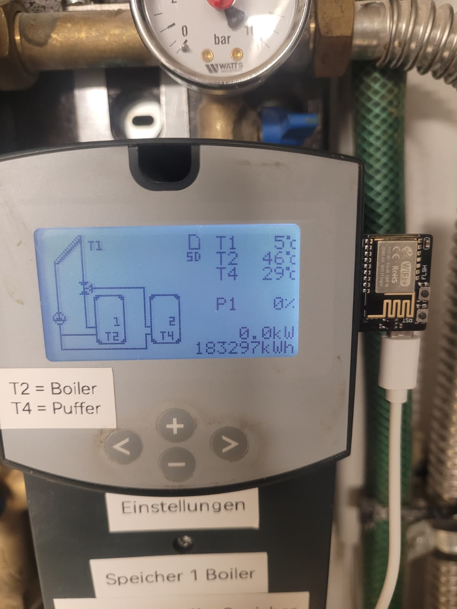
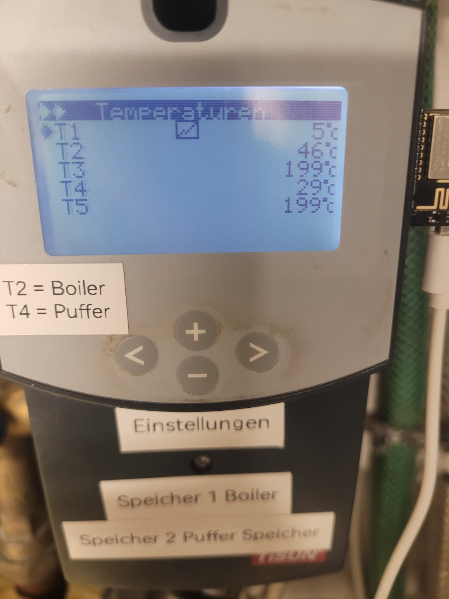
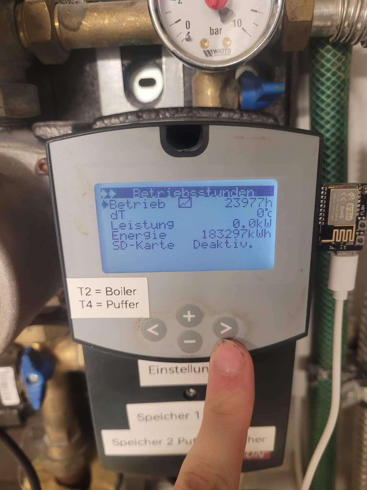
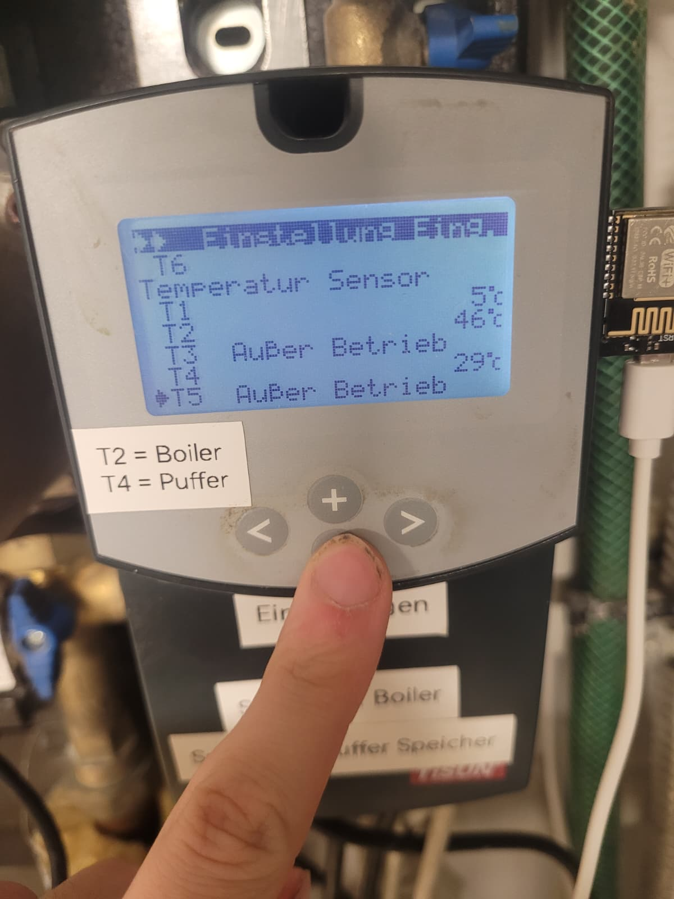
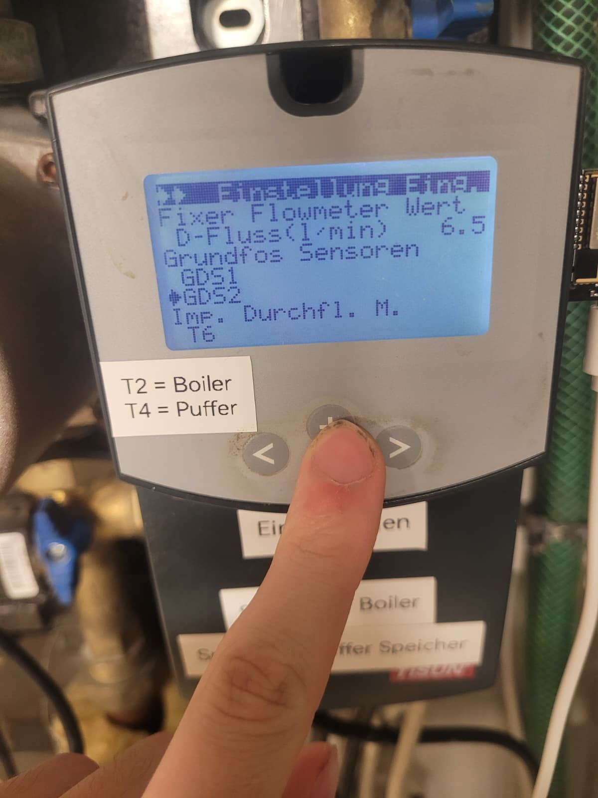

<p align="center">
  
</p>

# TiSUN MULTIPLEX → MQTT → Home Assistant



**Solarwerte vom TiSUN MULTIPLEX direkt in Home Assistant — ohne Cloud, ohne YAML, ohne OTA.**

Ein ESP8285 auf einem **FYSETC SD WiFi Card Reader V2.1** liest die Logdatei des
Reglers von der SD-Karte, schickt jede **neue** Messzeile per MQTT an Home
Assistant und legt die Sensoren dort automatisch an (MQTT Discovery). Feldnamen
lassen sich zur Laufzeit per MQTT ändern; Firmware-Updates gehen bewusst **nur
per USB**.


📖 [TiSUN MULTIPLEX Handbuch](https://www.manualslib.de/manual/527539/Tisun-Multiplex-Advanced.html) ·
🏢 [TiSUN GmbH](https://at.linkedin.com/company/tisun-gmbh) ·
🛒 [FYSETC SD-Reader](https://de.aliexpress.com/item/1005007594254365.html) ·
💾 [2-GB-microSD](https://www.ebay.de/itm/177224114334?var=476882283211)

---

## Warum das Ganze?

Mein TiSUN MULTIPLEX hat eine **RJ45-Netzwerkbuchse** für die PC-Software.
Darüber kam bei mir keine Verbindung zustande — die Daten waren einfach nicht
erreichbar. Also habe ich den zweiten Weg genommen, den der Regler anbietet:

> Der Regler schreibt seine Messwerte ohnehin alle **10 Minuten** als Klartext-Zeile
> auf die SD-Karte. Genau da hört der ESP mit.

Der FYSETC-Reader wird statt der SD-Karte in den Regler gesteckt. Der Regler
sieht weiterhin seine Karte, der ESP hängt am selben SPI-Bus und liest mit —
**ohne** dass etwas am Regler umgebaut oder geflasht werden muss.

```
TiSUN MULTIPLEX ──SD-Bus──► FYSETC SD-Reader (ESP8285) ──WLAN──► MQTT ──► Home Assistant
                                   │
                                   └─ liest nur, wenn der Regler nicht schreibt
```

---

## Inhalt

- [Was es kann](#was-es-kann)
- [So sieht es aus](#so-sieht-es-aus)
- [Was du brauchst](#was-du-brauchst)
- [Aufsetzen in 6 Schritten](#aufsetzen-in-6-schritten)
- [Wie es funktioniert](#wie-es-funktioniert)
- [Die Sensoren in Home Assistant](#die-sensoren-in-home-assistant)
- [Die Spalten der Logdatei](#die-spalten-der-logdatei)
- [MQTT-Topics](#mqtt-topics)
- [Fehlersuche](#fehlersuche)
- [Grenzen](#grenzen)
- [Links](#links)

---

## Was es kann

| | |
|---|---|
| 📄 **Liest nur Neues** | Merkt sich die Leseposition im EEPROM — nach einem Neustart wird nichts doppelt gesendet. |
| ⏱️ **Im 10-Minuten-Takt** | Der Regler schreibt alle 10 min eine Zeile; der ESP prüft alle 5 s die Datei und sendet sofort. |
| 🏠 **Home Assistant Discovery** | Sensoren entstehen automatisch. **Keine YAML.** |
| 🚫 **Filtert Unsinn** | `199` („Außer Betrieb") und `-40` (Fühler fehlt) werden nicht gesendet — die Entity bleibt grau, statt einen falschen Wert ins Diagramm zu schreiben. |
| 🤝 **Teilt sich den Bus** | Der Regler bleibt Master. Der ESP greift nur zu, wenn der Regler nicht schreibt. |
| ⚙️ **Fernkonfigurierbar** | Feldnamen, Einheiten und Grenzen per MQTT (`set_config`) änderbar. |
| 🔒 **Kein OTA** | Firmware-Update nur per USB. Kein Fernzugriff auf den Flash. |

---

## So sieht es aus

So sieht der Aufbau bei mir aus — der FYSETC-Reader sitzt seitlich am Regler,
das Display zeigt weiterhin die Anlage:

<table>
  <tr>
    <td width="50%" valign="top">
      <br>
      <sub><b>Übersicht:</b> T1 5 °C, T2 46 °C, T4 29 °C, P1 0 %, 0,0 kW,
      183297 kWh — der Reader hängt rechts am Gerät.</sub>
    </td>
    <td width="50%" valign="top">
      <br>
      <sub><b>Temperaturen:</b> T1 5 °C · T2 46 °C · T3 199 °C · T4 29 °C ·
      T5 199 °C. Genau diese Zahlen stehen in der Logzeile.</sub>
    </td>
  </tr>
  <tr>
    <td width="50%" valign="top">
      <br>
      <sub><b>Betrieb:</b> 23977 h, dT 0 °C, Leistung 0,0 kW, Energie
      183297 kWh — und der SD-Kartenstatus.</sub>
    </td>
    <td width="50%" valign="top">
      <br>
      <sub><b>Fühlerstatus:</b> T3 und T5 melden „Außer Betrieb" — im Log ist das
      die <code>199</code>. Deshalb wird sie nicht nach Home Assistant gesendet.</sub>
    </td>
  </tr>
  <tr>
    <td width="50%" valign="top">
      <br>
      <sub><b>Flowmeter:</b> fixer Wert 6,5 l/min und die Grundfos-Sensoren —
      stehen so nicht in der Logdatei.</sub>
    </td>
    <td width="50%" valign="top"></td>
  </tr>
</table>

In Home Assistant erscheint das Gerät **Solarlog** (Hersteller **TiSUN**) mit
diesen Sensoren:

| Sensor | Beispiel | Einheit | Icon |
|---|---|---|---|
| Solar Datum | `06.11.2026` | — | `mdi:calendar` |
| Solar Uhrzeit | `18:40` | — | `mdi:clock-outline` |
| Solar T1 … T5 | `5` / `46` / `29` | °C | `mdi:storage-tank` |
| Solar dT | `0` | K | `mdi:thermometer` |
| Solar Leistung | `0` | kW | `mdi:solar-power` |
| Solar P1 | `0` | % | `mdi:pump` |
| Solar Energie | `183297` | kWh | `mdi:lightning-bolt` |
| Solar Betrieb | `23977` | h | `mdi:counter` |
| Solarlog Letzte Logzeile | `06.11.2026 18:40` | Zeitstempel |
| Solarlog Letzter Refresh | wann der ESP gelesen hat | Zeitstempel |
| Solarlog Start · IP · Datei · Dateigröße · Leseposition · WLAN · Heap | Diagnose | — |

> **T2 = Boiler, T4 = Puffer.** So steht es auf dem Aufkleber an meinem Gerät.
> Die Sensornamen bleiben trotzdem neutral (`T1`…`T5`), weil die Rolle vom
> Anlagenaufbau abhängt.

---

## Was du brauchst

| Teil | Woher |
|---|---|
| **TiSUN MULTIPLEX** Solarregler | vorhanden — schreibt `WEJJMM.DAT` auf die SD-Karte |
| **FYSETC SD WiFi Card Reader V2.1** | [AliExpress](https://de.aliexpress.com/item/1005007594254365.html) |
| **microSD-Karte: genau 2 GB** | [2-GB-microSD bei eBay](https://www.ebay.de/itm/177224114334?var=476882283211) — **keine 4/8/16 GB**, siehe Warnung unten |
| USB-Seriell-Adapter (3,3 V) | zum Flashen, meist am FYSETC-Board schon dran |
| WLAN + MQTT-Broker | z. B. Home Assistant mit Mosquitto |

> [!IMPORTANT]
> **Nur eine 2-GB-microSD-Karte verwenden!**
> Bei 4 GB und größeren Karten hängt sich der TiSUN-Regler auf und schreibt
> **keine** Daten mehr auf die SD-Karte. Das ist keine Empfehlung, sondern
> Voraussetzung — auch wenn die Karte noch so gut passt.
>
> Geeignete Karte: **[2 GB microSD bei eBay](https://www.ebay.de/itm/177224114334?var=476882283211)**

**Pinbelegung** (FYSETC V2.1, einstellbar in `secrets.h`):

| Funktion | GPIO | Konstante |
|---|---|---|
| SD Chip-Select (ESP) | 4 | `SD_CS_PIN` |
| CS-Sense (Regler greift zu) | 5 | `CS_SENSE_PIN` |
| SPI MOSI / MISO / SCK | 13 / 12 / 14 | vom ESP8266-Core |

---

## Aufsetzen in 6 Schritten

### 1. Herunterladen und entpacken

Auf der GitHub-Seite den grünen Knopf **Code → Download ZIP** klicken und die
ZIP entpacken (Rechtsklick → *Alle extrahieren*). So ist das Projekt aufgebaut:

```
SolarLogReader/                ← dieser Ordner (das Repo)
├── README.md                  ← die Anleitung, die du gerade liest
├── img/                       ← Bilder für die Anleitung
├── beispiel-sd-karte/         ← Beispieldaten vom Regler (ganz unten erklärt)
└── SolarLogReader/            ← DIESEN Ordner öffnest du in der Arduino IDE
    ├── SolarLogReader.ino     ← der Sketch
    ├── fields.h               ← welcher Wert ist welcher Sensor
    ├── secrets.example.h      ← Vorlage für deine Zugangsdaten
    └── secrets.h              ← entsteht in Schritt 2 (nicht im Repo)
```

> **Warum zwei Ordner mit demselben Namen?** Die Arduino IDE verlangt, dass der
> Sketch-Ordner genauso heißt wie die `.ino`-Datei. Der **innere** Ordner ist
> dein Arduino-Projekt, der **äußere** ist die GitHub-Seite mit Anleitung und
> Bildern. Genau so muss es sein — bitte nicht umbenennen.

### 2. `secrets.example.h` → `secrets.h` machen

Das ist der einzige Schritt, den man leicht vergisst: **umbenennen**, nicht nur
kopieren.

```bash
cd SolarLogReader/SolarLogReader
cp secrets.example.h secrets.h
```

(Der erste `SolarLogReader` ist der Repo-Ordner, der zweite dein
Arduino-Projekt.)

Unter Windows im Explorer: Rechtsklick → *Umbenennen* → `secrets.h`.
(`secrets.h` steht in `.gitignore` und landet **nicht** auf GitHub.)

### 3. Zugangsdaten eintragen

`secrets.h` im Editor öffnen und oben ausfüllen:

```c
#define WIFI_SSID     "MeinWLAN"
#define WIFI_PASSWORD "Geheim123"

#define MQTT_BROKER   "192.168.0.2"      // IP des Brokers (Home Assistant)
#define MQTT_PORT     1883
#define MQTT_USER     "mqtt_user"        // leer lassen = anonym
#define MQTT_PASS     "mqtt_pass"
#define MQTT_CLIENT_ID "fysetc-solarlog-reader"

#define SD_CS_PIN      4                 // FYSETC V2.1
#define CS_SENSE_PIN   5
#define NTP_SERVER     "pool.ntp.org"
```

> Nur diese Werte anfassen — der Rest der Datei (Topics, Dateinamen) passt
> für die Standardinstallation.

### 4. Arduino IDE einrichten

**a) ESP8266-Core installieren**

*Datei → Einstellungen → Zusätzliche Boardverwalter-URLs:*

```
https://arduino.esp8266.com/stable/package_esp8266com_index.json
```

Dann *Werkzeuge → Board → Boardverwalter*, nach **esp8266** suchen und
installieren (getestet mit **2.4.0**, neuer geht auch).

**b) Library installieren**

*Werkzeuge → Bibliotheken verwalten* → **PubSubClient** von Nick O'Leary
installieren.

**c) Board einstellen**

| Einstellung | Wert |
|---|---|
| Board | **Generic ESP8285 Module** |
| Upload Speed | `115200` |
| Port | der COM-Port des USB-Adapters |
| Serial Monitor | `115200` |

### 5. Flashen

1. Im entpackten Ordner **`SolarLogReader/SolarLogReader`** die Datei
   `SolarLogReader.ino` doppelklicken — die Arduino IDE öffnet das Projekt samt
   `fields.h` und `secrets.h` (beide liegen im selben Ordner und werden
   automatisch mitkompiliert).
2. USB-Adapter anstecken, **Hochladen** klicken.
3. Seriellen Monitor auf **115200** öffnen. Nach dem Boot sollte so etwas stehen:

```
=== SolarLogReader startet (Remote-Config) ===
[WiFi] IP: 192.168.0.76
[CFG] Remote-Config geladen, Felder: 12
[SD] Karte bereit
[SD] size=441 lastPos=441
[SD] nichts Neues
```

### 6. Einstecken

1. Strom weg vom Regler (oder Regler aus).
2. **SD-Karte aus dem Regler** nehmen und in den FYSETC-Reader stecken.
3. Den Reader in den SD-Slot des Reglers stecken (er ersetzt die Karte).
4. Regler einschalten.

Nach wenigen Sekunden erscheint in Home Assistant unter
*Einstellungen → Geräte & Dienste → MQTT* das Gerät **Solarlog** mit allen
Sensoren. Fertig — **es muss nichts in `configuration.yaml` eingetragen werden.**

**Update später:** wieder per USB anstecken und normal hochladen. OTA ist
absichtlich nicht eingebaut.

---

## Wie es funktioniert

**Der Takt kommt vom Regler, nicht vom ESP.**
Der MULTIPLEX schreibt alle **10 Minuten** eine Zeile in `WEJJMM.DAT`
(z. B. `WE2611.DAT` für November 2026). Der ESP schaut alle 10 Sekunden nach, ob
die Datei gewachsen ist, und sendet die neue Zeile sofort. Zwischendurch passiert
nichts — kein Polling des Reglers, keine Last auf dem Bus.

**Nur neue Zeilen.**
Die Leseposition steht im EEPROM. Nach einem Neustart geht es genau dort weiter;
alte Zeilen werden nicht erneut gesendet. Beim Start wird zusätzlich einmal die
letzte Zeile ausgewertet, damit die Sensoren sofort gefüllt sind.

**Funk nur, wenn es sein muss.**
Messwerte gehen sofort raus, sobald eine neue Zeile da ist. Die Telemetrie
(WLAN-Stärke, Heap, Dateigröße, Leseposition) wird dagegen nur bei Änderung oder
alle **10 Minuten** gesendet (`TELEMETRY_INTERVAL_MS`) — der ESP funkt dazwischen gar nicht.

**Der Bus bleibt beim Regler.**
`CS_SENSE` (GPIO 5) geht auf LOW, wenn der Regler auf die Karte zugreift. Der ESP
wartet dann 20 Sekunden und versucht es später erneut. Zwischen den Zugriffen
gibt er MISO/MOSI/SCK wieder frei — der Regler merkt nichts vom Mitleser.

**Aufgeräumt wird auch.**
Bei 1,5 GB wird die Datei geleert, beim Monatswechsel werden **ältere**
Monatsdateien gelöscht (die aktuelle nie).

**Kein Cloud-Dienst.**
Alles läuft im lokalen Netz: ESP → MQTT-Broker → Home Assistant.

---

## Die Sensoren in Home Assistant

Nichts zu konfigurieren: Der Broker ist in HA eingerichtet, der ESP sendet
Discovery, die Entitäten entstehen von selbst.

Zwei Zeitstempel, die oft verwechselt werden:

| Sensor | Bedeutung |
|---|---|
| **Solarlog Letzte Logzeile** | Die Uhrzeit aus der Logzeile (Spalte 0/1), z. B. `18:40`. |
| **Solarlog Letzter Refresh** | Wann der ESP die Datei zuletzt gelesen hat. |

HA zeigt Zeitstempel in der Liste relativ an („Vor 2 Minuten", „In 35 Sekunden").
Der echte Wert steht in der Detailansicht. Ein Wert „in der Zukunft" heißt nur,
dass die Uhr des Reglers ein paar Sekunden vorgeht.

**Ganze Zahlen und Icons:** Alle Messwerte gehen als ganze Zahlen raus
(`divider: 0` in `fields.h`) — `46`, nicht `46.0`. Das Icon jedes Sensors steht
in der Discovery-Payload (`icon`) und ist damit auch per MQTT änderbar:

```json
{"index":15,"icon":"mdi:pump"}
```

Ein geändertes Icon gilt wie `min`/`max` nur bis zum Neustart; der Standard steht
in `fields.h`.

**Graue Sensoren sind Absicht:** `T3`/`T5` mit `199` („Außer Betrieb") oder
`-40` (Fühler fehlt) werden nicht gesendet. Kommt der Fühler zurück, legt der
ESP die Entity beim ersten gültigen Wert wieder an.

---

## Die Spalten der Logdatei

Die Bedeutung steht **nicht** im TiSUN-Handbuch. Das Mapping wurde durch
Vergleich der Logzeile mit dem Display ermittelt:


```
1106;1830;10;46;199;30;199;-40;...;183297;023977;25;1.5;...;EU;6123;...
 │     │    └── T1..T5 roh in °C ──┘        │      │
 │     └── Uhrzeit HHMM                    │      └── Betriebsstunden
 └── Datum MMDD                           └── Energie kWh
```

| Spalte | Beispiel | Bedeutung | Plausibel |
|---|---|---|---|
| 0 | `1106` | Datum `MMDD` → `06.11.2026` | — |
| 1 | `1830` | Uhrzeit `HHMM` → `18:30` | — |
| 2–6 | `10;46;199;30;199` | `T1`…`T5`, **roh in °C, ganzzahlig** (kein Teiler) | −35…150 |
| 7–12 | `-40` | Fühler nicht belegt (nicht gemappt) | — |
| 13 | `0.0` | `dT` in K | −35…150 |
| 14 | `0.0` | `Leistung` in kW | 0…200 |
| 15 | `0` | `P1` in % | 0…100 |
| 25 | `183297` | `Energie` in kWh | 0…2 000 000 |
| 26 | `023977` | `Betrieb` in h | 0…200 000 |
| 27 / 28 | `25` / `1.5` | unbekannt (nicht gemappt) | — |
| 39 / 40 | `EU` / `6123` | Sprache / Variante | — |

**`199` heißt „Außer Betrieb", nicht 19,9 °C.** `-40` heißt „Fühler fehlt".

Namen und Grenzen stehen in `fields.h` und lassen sich **ohne Neufassung** per
MQTT ändern — Topic `home/solarlog/set_config`:

```json
{"index":4,"key":"kollektor","name":"Kollektor","unit":"°C","divider":0,"min":-35,"max":150,"icon":"mdi:storage-tank"}

{"cmd":"list"}
{"cmd":"reset"}
```

| Schlüssel | Bedeutung |
|---|---|
| `index` | Spalte in der Zeile, ab 0 (`1106;1830;…` → 0 = 1106) |
| `key` | MQTT-Endung, nur Kleinbuchstaben/Unterstrich → `home/solarlog/<key>` |
| `name` | Anzeigename in Home Assistant |
| `unit` | z. B. `°C`, `%`, `kWh`, `""` |
| `icon` | MDI-Name, z. B. `mdi:storage-tank`, `mdi:pump`, `mdi:lightning-bolt` (leer = kein Icon) |
| `divider` | `0` = ganzzahlig, `10` = durch 10 teilen |
| `min` / `max` | Plausibilitätsgrenzen; außerhalb wird **nicht** gesendet (nur zur Laufzeit) |

Antwort kommt auf `home/solarlog/config_state`.

---

## MQTT-Topics

Alles unter `home/solarlog/`:

| Topic | Inhalt | retained |
|---|---|---|
| `values` | komplette Rohzeile als JSON (`raw`, `pos`, `file`, `mtime`) | nein |
| `status` | Größe, Position, IP, RSSI, Uptime, Heap (JSON) | nein |
| `datum`, `uhrzeit`, `t1`…`t5`, `dt`, `leistung`, `p1`, `energie`, `betrieb` | Messwerte | ja |
| `meas_time` | Messzeit der letzten Logzeile (UTC) | ja |
| `last_refresh` | wann der ESP zuletzt gelesen hat (UTC) | ja |
| `ip`, `file`, `size`, `pos`, `rssi`, `heap`, `uptime` | Telemetrie | ja |
| `set_config` / `config_state` | Fernkonfiguration | nein |

Discovery: `homeassistant/sensor/solarlog_<key>/config` (retained).

**Zeitzone:** Alle Zeitstempel gehen als **UTC mit `Z`** raus; HA rechnet selbst
um. Die Logzeit ist Ortszeit und wird im ESP inklusive deutscher
Sommerzeit-Regel (letzter Sonntag im März/Oktober) nach UTC umgerechnet.

---

## Fehlersuche

**`[SD] Init fehlgeschlagen, naechster Versuch in 30 s`**
Karte sitzt nicht richtig, Versorgung zu schwach oder der Regler belegt den Bus
dauerhaft. Der Sketch versucht es mit Backoff (15/30/60 s) erneut und mountet
nach einem Fehler selbst neu — kein Neustart nötig.

**`[SD] Regler aktiv, uebersprungen`**
Kein Fehler: Der Regler schreibt gerade auf die Karte, der ESP wartet.

**Werte aktualisieren sich nur nach einem Neustart**
Der Regler trennt seine Zeilen mit CR (`\r`), nicht mit LF. Der Sketch liest
deshalb zeichenweise und trennt an CR **und** LF; die Leseposition bleibt auf der
letzten vollständigen Zeile stehen. Zusätzlich wird alle 10 s die letzte Zeile
der Datei geprüft (unabhängig von der Leseposition).

**Sensoren bleiben „Unbekannt"**
Werte werden retained gesendet. Kommt trotzdem nichts an, liefert der Regler
seit Stunden keine neue Zeile oder MQTT ist getrennt — `last_refresh` zeigt den
letzten Lesevorgang, die serielle Ausgabe zeigt `[SD] nichts Neues`.

**`Solar T3`/`T5` fehlen oder sind grau**
Richtig so: `199` = „Außer Betrieb" wird gefiltert.

**Uhrzeit/Datum falsch**
NTP prüfen (`NTP_SERVER`). Der ESP läuft bewusst auf UTC — die Anzeige macht
Home Assistant.

---

## Grenzen

- **Rückdatierung:** HA zeichnet Messwerte mit der Empfangszeit. Für exakte
  Zeitachsen braucht es InfluxDB/Grafana — der ESP liefert `meas_time` mit.
- **Spalte 27/28** sind unbekannt (28 ist konstant `1.5`, auch bei stehender
  Pumpe — deshalb nicht gemappt).
- **Schreibzugriffe:** Nur der 1,5-GB-Reset und das Anlegen einer fehlenden
  Monatsdatei schreiben auf die Karte des Reglers.
- **Andere Firmware:** Nicht jeder MULTIPLEX schreibt dieselben Spalten. Das
  Mapping ist an einem Gerät mit `WE2611.DAT` verifiziert — bei Abweichungen per
  `set_config` korrigieren.
- **Kein OTA:** Updates nur per USB.

---

## Dateien im Repo

| Datei | Zweck |
|---|---|
| `README.md` | diese Anleitung |
| `img/` | Bilder für die Anleitung |
| `SolarLogReader/SolarLogReader.ino` | der Sketch (SD, MQTT, Discovery, Filter) |
| `SolarLogReader/fields.h` | Spalten-Mapping, Namen, Einheiten, Plausibilitätsgrenzen |
| `SolarLogReader/secrets.example.h` | Vorlage — kopieren nach `secrets.h` und ausfüllen |
| `SolarLogReader/secrets.h` | **nicht im Repo** — deine Zugangsdaten |
| `README_remote.md` | Kurzfassung zu `set_config` |
| `.gitignore` | hält `secrets.h` und Build-Artefakte draußen |

---

## Links

- **TiSUN MULTIPLEX Handbuch:** [manualslib.de](https://www.manualslib.de/manual/527539/Tisun-Multiplex-Advanced.html)
- **TiSUN GmbH (Logo/Hersteller):** [LinkedIn](https://at.linkedin.com/company/tisun-gmbh)
- **2-GB-microSD-Karte (Pflicht):** [eBay](https://www.ebay.de/itm/177224114334?var=476882283211)
- **FYSETC SD WiFi Card Reader V2.1:** [AliExpress](https://de.aliexpress.com/item/1005007594254365.html)
- **ESP8266-Core für Arduino:** [arduino.esp8266.com](https://arduino.esp8266.com/stable/package_esp8266com_index.json)
- **PubSubClient:** [github.com/knolleary/pubsubclient](https://github.com/knolleary/pubsubclient)
- **Referenzfoto Solarregler:** [Bild](https://encrypted-tbn0.gstatic.com/images?q=tbn:ANd9GcQGFSiFOGtO3hBpye0oxgYlu3Rf0HLmx5VtLBC1YImHJw&s=10)

---

*Gebaut für einen TiSUN MULTIPLEX, der seine Daten partout nicht über die
Netzwerkbuchse herausrücken wollte. Die SD-Karte tut es.*

---

<details>
<summary><b>📄 Beispieldaten vom Regler — was liegt in <code>beispiel-sd-karte/</code>?</b></summary>

<br>

Im Ordner **`beispiel-sd-karte/`** liegen zwei Dateien, die ich von der SD-Karte
des Reglers kopiert habe. Sie sind **nur zum Nachschauen** gedacht:

| Datei | Größe | Inhalt |
|---|---|---|
| `WE2611.DAT` | 295 B | zwei echte Logzeilen vom 06.11.2026 (18:30 und 18:40) |
| `WEPARA.INI` | 415 B | Parameterdatei des Reglers, binär — nur zur Vollständigkeit |

**So sieht eine Logzeile aus** (gekürzt):

```
1106;1830;10;46;199;30;199;-40;-40;-40;...;183297;023977;25;1.5;...;EU;6123;...
```

Was die einzelnen Spalten bedeuten, steht weiter oben unter
[Die Spalten der Logdatei](#die-spalten-der-logdatei).

> ⚠️ **Nicht auf die Karte kopieren.** Der Regler schreibt seine eigene Datei —
> eine fremde Kopie würde seine Historie überschreiben. Die Datei dient nur
> dazu, das Format zu verstehen und Spalten nachzuzählen.

> 💡 **Zeilenende ist CR.** Die Zeilen enden mit `\r`, nicht mit `\n` — daran
> hat sich der Lesecode anfangs verschluckt. Der Sketch trennt deshalb an
> beiden Zeichen.

</details>
